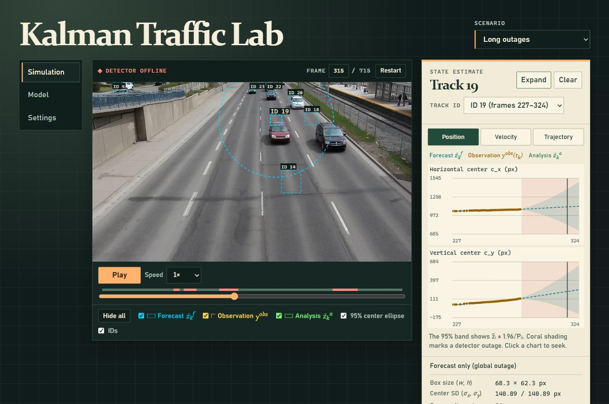
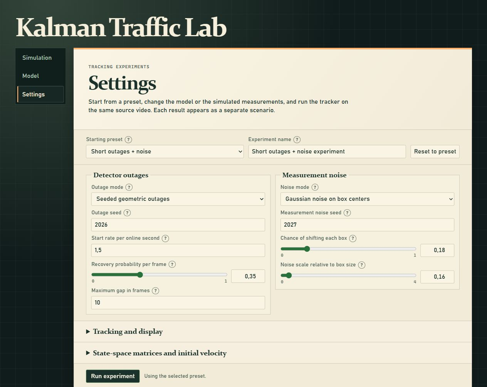
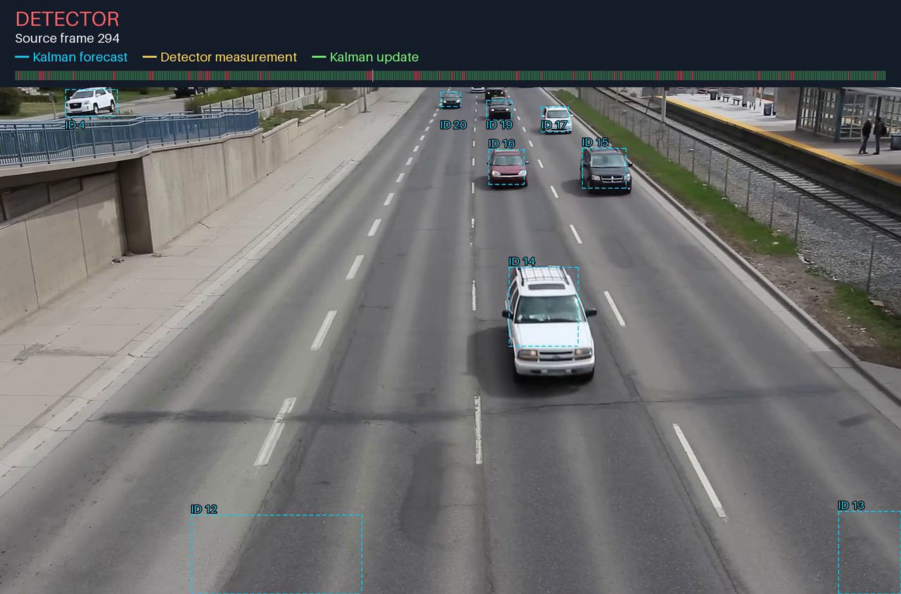
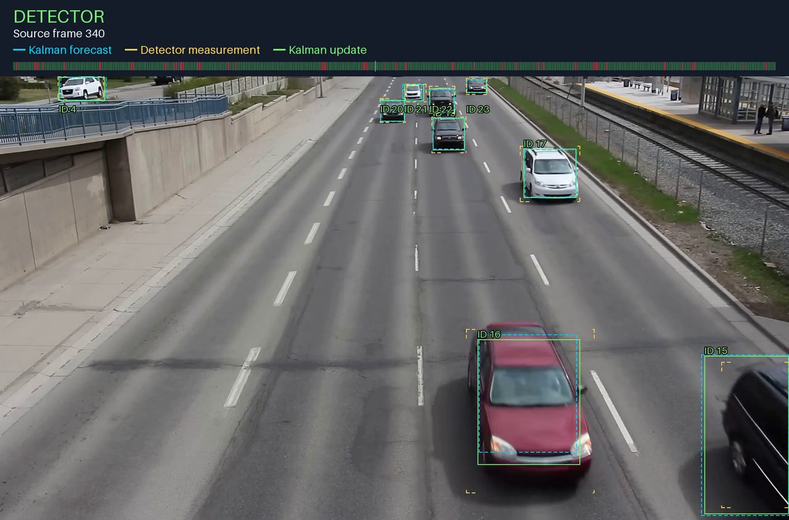
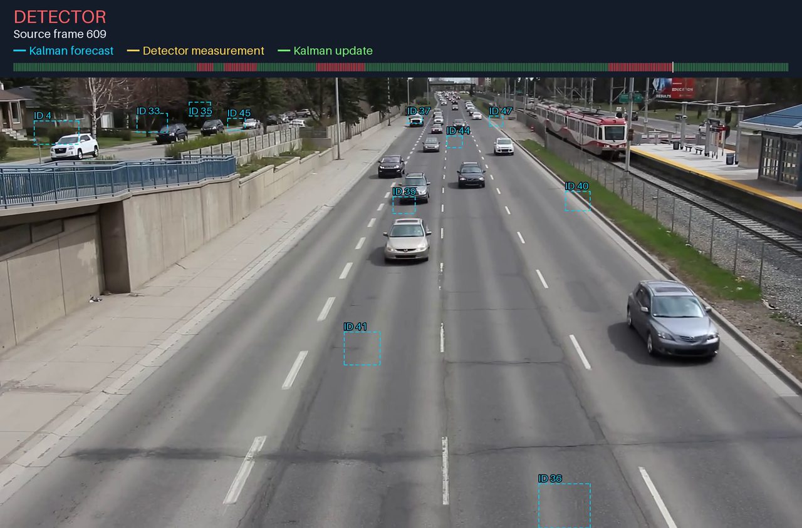

# Kalman Traffic Test

An interactive browser lab for teaching the **linear Kalman filter** with traffic footage. YOLO supplies bounding-box observations. The filter estimates each track's box center, size, velocity, and uncertainty.

[Open the classroom site](https://kalman-filter.tmgoslin.workers.dev/) | [Quick start](#quick-start) | [Custom experiments](#custom-experiments) | [Four standard scenarios](#four-simulation-examples) | [Annotated video and frame exports](#run)



*During a long detector outage, the filter continues to forecast. The ellipse and chart bands show how its modeled uncertainty grows.*

## Quick start

Bring a local video and install **Python 3.11+**, FFmpeg, and ffprobe. Make sure both FFmpeg commands are on PATH, then install the Python packages from the repository root.

```powershell
python -m pip install -r requirements.txt
```

Create `inputs/` and save your clip as `inputs/videoplayback.mp4`. Run YOLO once to create the detection cache. The command also writes a baseline annotated video.

```powershell
python -m traffic_lab.render inputs/videoplayback.mp4 outputs/traffic-demo.mp4 --classes 2
```

**On Windows**, double-click **Traffic Lab.cmd**, choose **Start**, and open [the local lab](http://127.0.0.1:8000/). Start builds the four standard scenarios if their export is missing.

**From a terminal**, you can build the export and start the same local server directly.

```powershell
python -m traffic_lab.export
python -m traffic_lab.server
```

The weights may download on the first YOLO pass. Source video and local weights under `inputs/`, plus generated videos, caches, and experiments under `outputs/`, stay local. The [setup guide](docs/interactive.md) covers refresh, rebuilding, and stopping the server.

## Classroom mode

Open the [live classroom site](https://kalman-filter.tmgoslin.workers.dev/) and enter the shared class PIN to use the fixed clip without installing anything. The same repository also supports a laptop workflow with uploads.
The classroom site includes the four presets, bundles the existing detections, and runs the same
Python Kalman simulation in a browser worker. Detector settings are fixed. Custom experiments are
stored in the browser on that device. The first run downloads the browser Python runtime.

The repository includes one fixed clip and its raw YOLO cache under `classroom_assets/`.
The build regenerates all four scenarios from that one cache. It needs Python 3.11+, NumPy,
and SciPy. The bundled frame timestamps allow classroom builds without FFmpeg or YOLO.

Build and preview the classroom version:

```powershell
python -m traffic_lab.classroom build
python -m traffic_lab.classroom serve
```

Open [the classroom preview](http://127.0.0.1:8001/). The normal laptop launcher still runs on
port 8000. Rebuild the classroom output after changing the shared viewer or simulation code.

### Update the live site from main

The [Deploy classroom workflow](https://github.com/thomasgoslin/kalman-filter-traffic-demo/actions/workflows/deploy-classroom.yml)
builds and deploys pushes to `main`. It uses a Cloudflare token scoped to the classroom Worker.
Check the run in GitHub Actions after pushing, or use **Run workflow** from the same page to deploy
`main` again.

The workflow uses the repository secret `CLOUDFLARE_API_TOKEN` and the repository variable
`CLOUDFLARE_ACCOUNT_ID` under **Settings → Secrets and variables → Actions**.
To deploy manually, use `npm ci`, `npx cf auth login`, `npm run build:classroom`, and
`npm run deploy:classroom`.

The live site checks the shared PIN in a Cloudflare Worker before serving the page, video, or
data. The Worker reads the eight-digit `CLASSROOM_PIN` and a separate 64-character hexadecimal
`CLASSROOM_SESSION_KEY` from Cloudflare secrets. Set or rotate them using a private JSON file with
`npx cf deploy --no-provision --secrets-file <private-json-file>` after building the classroom site.
Rotating the PIN invalidates earlier sessions. Student sessions last up to 12 hours. The PIN does
not restrict access to the copies of the clip and detections in this public repository.

Only the Worker and `outputs/classroom` are deployed. Personal inputs, uploads, and generated outputs stay
out of Git. The committed MP4 and raw detection cache are the classroom's two fixed inputs.

For a quick classroom exercise, start from **Short outages + noise** and keep the seed fixed.
Run two experiments with different values of the observation covariance `R`. Compare how strongly
the green analysis follows the yellow measurements for one clearly visible car.

## Explore the lab

- **Simulation.** Play or scrub the video, enter an exact frame, and click a track. Compare the cyan forecast, yellow observation, and green analysis. Open Position, Velocity, or Trajectory and choose **Expand** for a larger graph.
- **Model.** Follow the notation of Reich and Cotter's §6.1 and Algorithm 6.3. The view shows the forecast and analysis equations and the matrices used by the selected run.
- **Settings.** Change the simulated outages and measurement noise, then compute a new scenario from your settings.

## Custom experiments



1. Choose a **Starting preset** and name the experiment. Use the sliders, exact number fields, and **?** help buttons to explore the parameters. **Reset to preset** restores the form values.
2. Change the outage mode, seeds, or Gaussian measurement noise. **Tracking and display** contains detector settings, matching and track lifetime controls, and the uncertainty display percentage. **State-space matrices and initial velocity** contains the filter matrices, per-frame offset, and initial velocity.
3. Choose **Run experiment**, then **Open in Simulation**. The result is saved as a separate local scenario alongside the four presets.

Use **Source video** in Settings to upload an MP4 (up to 60 seconds and 100 MB) or switch between clips. Uploads use the default YOLO weights from `inputs/` and are processed once before their presets become available. **Saved experiments** lists the active clip’s custom runs and lets you delete them.

The standard scenarios are exported once and loaded as you switch between them. The local server computes custom runs on demand. Matching detector settings reuse cached readings. Changing detector settings can require a fresh YOLO pass using local weights.

## Four simulation examples

| Preset | What it illustrates |
| --- | --- |
| Baseline | Forecast, observation, and analysis during ordinary tracking |
| Short outages | Prediction continues through seeded measurement gaps |
| Short outages + noise | The filter combines its forecast with occasionally perturbed detector boxes |
| Long outages | Fixed gaps of 15, 30, 45, and 60 frames show forecast drift |

<details>
<summary>See the annotated export examples</summary>

### 1. Normal tracking


**Frame 319.** The detector supplies a yellow box from the current image. The blue box predicts the car's position from earlier frames. The green box comes from the Kalman update, which uses the current detection to correct the forecast.

### 2. Short detector outages



**Frame 294.** This is the last frame of a six-frame gap. The red status marks a withheld detector reading, and the blue boxes are forecasts from the last available estimate. This screenshot uses an earlier six-frame cap for the seeded geometric outages.

### 3. Short outages with noisy detections



**Frame 340.** This run uses the same outage schedule and occasionally shifts available detector boxes with Gaussian noise. On the red car (ID 16), the yellow center shifts about **24 px** from the original detector reading. The green center ends up about **4 px** from that same reference. This is a controlled comparison against the saved reading before noise was added.

### 4. Long outages and forecast drift



**Frame 609.** This is the final frame of the 60-frame gap in a run with deliberately scheduled gaps of 15, 30, 45, and 60 frames. Several blue boxes have drifted away from the cars. A model that assumes constant image-plane velocity and carries box size forward can work over short gaps, but perspective and vehicle motion make that approximation deteriorate over time.

</details>

## Run

Use the setup above. To export annotated PNGs alongside an MP4, run:

```powershell
python -m traffic_lab.render inputs/videoplayback.mp4 outputs/traffic-demo.mp4 --classes 2 --frames-dir outputs/traffic-demo-frames
```

The model weights may download on the first run. Use `--weights inputs/yolo26n.pt` if you already have a local copy. The example selects cars with the default detector. Omit `--classes 2` to keep all detected classes.

Keep rendered MP4s, detection caches, and PNG folders under `outputs/`, which Git ignores. With `--frames-dir`, the script exports every annotated frame as a PNG. For example, frame 341 is `frame_000341.png`. Pick a new folder for each frame export.

Use `--cache` with the same video to render again without detector inference. The script reads detector settings from the cache when you omit them, so playback also works after moving the project or the model weights. If you specify detector settings explicitly, they must match the cache. Add `--drop-frames 300:303` to illustrate a missed detection on frames 300 through 302. See `python -m traffic_lab.render --help` for the remaining options.

The [implementation brief](docs/implementation.md) explains the filter and its checks.

## Project layout

- [`traffic_lab/`](traffic_lab/) contains the tracker, shared presets, local experiment server, and video and browser exports.
- [`interactive_web/`](interactive_web/) contains the static browser interface.
- [`docs/`](docs/) contains setup instructions, technical notes, and example images.

Run `python -m traffic_lab.export` to rebuild the interactive data, or `python -m traffic_lab.batch` to rerender all four annotated videos. The Windows launcher and original script commands also work.

## Presentation cut

`--presentation` adds a status header and timeline above the full, original video frame. The boxes and track labels use the same renderer as the regular output. The **DETECTOR** label and timeline use green for online frames and red for simulated outages. Each block represents one source frame, and the white outline highlights the current frame.

After producing the detection cache with the first command, this example makes a real-time excerpt with four short detector gaps:

```powershell
python -m traffic_lab.render inputs/videoplayback.mp4 outputs/intermittent-outage.mp4 --classes 2 --cache outputs/traffic-demo.detections.json --presentation --clip-frames 250:370 --drop-frames 294:299 --drop-frames 302:308 --drop-frames 312:319 --drop-frames 323:327 --frames-dir outputs/intermittent-outage-frames
```

All ranges are zero-based and exclude their end frame. The filter processes the preceding frames to establish each track. The video plays each selected frame once at the source frame rate. PNGs keep their original source frame numbers.

For the full traffic clip, omit `--clip-frames`. Use `--drop-frames 170:185 --drop-frames 195:225 --drop-frames 280:325 --drop-frames 550:610 --max-misses 60` to reproduce gaps of 15, 30, 45, and 60 frames. The longer miss allowance applies during the outage. While the detector is online, an unmatched track can coast for up to eight frames. When detections return, unmatched existing tracks are retired and unmatched detections start new tracks.

## Seeded detector dropouts

```powershell
python -m traffic_lab.render inputs/videoplayback.mp4 outputs/random-dropouts.mp4 --classes 2 --cache outputs/traffic-demo.detections.json --presentation --outage-seed 2026 --max-misses 10 --frames-dir outputs/random-dropouts-frames
```

The simulation alternates online periods with short outages. The wait to start an outage while online is geometric in frames, with start probability `1 - exp(-1.5 / fps)` per frame. This is the frame-by-frame version of an exponential wait at 1.5 starts per online second. Outage lengths are geometric with a recovery probability of 0.35 per missing frame, capped at ten frames.

The same integer seed, source frame count, frame rate, and settings produce the same schedule. A seeded run writes its exact zero-based, end-exclusive ranges to a `.schedule.json` file alongside the MP4. It saves detector boxes as recorded and withholds measurements only during tracking. Choose either `--outage-seed` or explicit `--drop-frames` ranges.

## Occasional noisy detections

```powershell
python -m traffic_lab.render inputs/videoplayback.mp4 outputs/noisy-dropouts.mp4 --classes 2 --cache outputs/traffic-demo.detections.json --presentation --outage-seed 2026 --max-misses 10 --sensor-noise-std 0.16 --sensor-noise-probability 0.18 --sensor-noise-seed 2027
```

For each available detection, a Bernoulli draw selects whether to perturb it. If selected, independent zero-mean Gaussian offsets shift its center horizontally and vertically. A scale of `0.16` means standard deviations of 16% of the box width and height on the respective axes. Box size, class, confidence, and the saved detections stay as recorded. During a dropout, no measurements reach the tracker.

The scale defaults to zero. The noise seed controls perturbations independently of the outage seed. Replay the same source, detector settings, and outage schedule to reproduce the shifts. For seeded outage runs, the schedule JSON also records the noise settings.

The yellow box shows the measurement the tracker receives. The filter uses its usual measurement covariance and can dampen shifts, especially when the forecast is reliable. Large shifts can still pull an estimate off course or cause a missed match.
