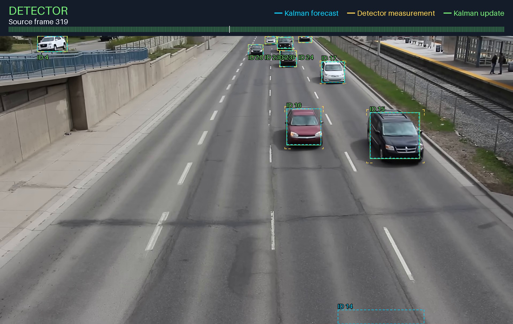

# Kalman Traffic Lab

An interactive browser demo for teaching the **linear Kalman filter** with traffic footage. A pretrained YOLO detector supplies bounding boxes, and a constant-velocity filter estimates each car's position, box size, and image-plane velocity.

[Run the lab locally](README-interactive.md) | [See the four scenarios](#four-simulation-examples) | [Render annotated clips](#run)


*At frame 315 of the long-outage scenario, track 19 has gone 36 frames without a measurement. The filter still forecasts the car's position, while the ellipse and shaded bands show its growing uncertainty.*

## What you can explore

- **Play and inspect the original video.** Use Space to play or pause, change speed up to 2×, or enter an exact frame in the counter beside Restart. Click a box to pin its track and open the inspector.
- **Read the forecast and analysis side by side.** Cyan dashes show the forecast, yellow corners show the detector measurement, and a solid green rectangle shows the Kalman update. Toggle layers individually or use **Hide all**.
- **Follow the state and its uncertainty.** The position, velocity, and trajectory views use the estimator's recorded means and covariances. The 95% center ellipse and chart bands show uncertainty under the model. Choose **Expand** for larger graphs with more readable axes, or click a time-series chart to seek to its source frame.
- **See what happens when measurements disappear and return.** Switch among baseline tracking, short seeded outages, short outages with noisy measurements, and long outages. Matched tracks keep their IDs when detections return. Unmatched old tracks retire and their history remains available.

The lab illustrates the forecast and analysis steps in Algorithm 6.3 of Reich and Cotter's *Probabilistic Forecasting and Bayesian Data Assimilation*. The outage and noise scenarios are simulated.

## Open the browser demo

After [creating a local detection cache](#run), double-click **Traffic Lab.cmd** on Windows and choose **Start**. Open the local URL printed by the launcher. The [interactive setup guide](README-interactive.md) covers first-time setup and how to refresh the browser files. The original footage and generated data stay local.

## Four simulation examples

All four runs use the same traffic clip, saved detector readings, and tracker code. The detector outages and measurement jitter are simulated.

### 1. Normal tracking



**Frame 319.** The detector supplies a yellow box from the current image. The blue box predicts the car's position from earlier frames. The green box comes from the Kalman update, which uses the current detection to correct the forecast.

### 2. Short detector outages


**Frame 294.** This is the last frame of a six-frame gap. The red status marks a withheld detector reading, and the blue boxes are forecasts from the last available estimate. This screenshot uses an earlier six-frame cap for the seeded geometric outages.

### 3. Short outages with noisy detections


**Frame 340.** This run uses the same outage schedule and occasionally shifts available detector boxes with Gaussian noise. On the red car (ID 16), the yellow center shifts about **24 px** from the original detector reading. The green center ends up about **4 px** from that same reference. This is a controlled comparison against the saved reading before noise was added.

### 4. Long outages and forecast drift


**Frame 609.** This is the final frame of the 60-frame gap in a run with deliberately scheduled gaps of 15, 30, 45, and 60 frames. Several blue boxes have drifted away from the cars. A model that assumes constant image-plane velocity and carries box size forward can work over short gaps, but perspective and vehicle motion make that approximation deteriorate over time.

## Run

Use Python 3.11 or later and make `ffmpeg` and `ffprobe` available on PATH. Supply your own local video and use its path in place of `videoplayback.mp4` in the examples. Paths can be absolute or relative to your working directory. From the repository folder, install dependencies and run:

```powershell
python -m pip install -r requirements.txt
python kalman_filter_demo.py videoplayback.mp4 outputs/traffic-demo.mp4 --classes 2 --frames-dir outputs/traffic-demo-frames
```

The model weights may download on the first run. Use `--weights yolo26n.pt` if you already have a local copy. The example selects cars with the default detector. Omit `--classes 2` to keep all detected classes.

Keep rendered MP4s, detection caches, and PNG folders under `outputs/`, which Git ignores. With `--frames-dir`, the script exports every annotated frame as a PNG. For example, frame 341 is `frame_000341.png`. Pick a new folder for each frame export.

Use `--cache` with the same video to render again without detector inference. The script reads detector settings from the cache when you omit them, so playback also works after moving the project or the model weights. If you specify detector settings explicitly, they must match the cache. Add `--drop-frames 300:303` to illustrate a missed detection on frames 300 through 302. See `python kalman_filter_demo.py --help` for the remaining options.

The [implementation brief](kalman-filter-demo-implementation.md) explains the filter and its checks.

## Presentation cut

`--presentation` adds a status header and timeline above the full, original video frame. The boxes and track labels use the same renderer as the regular output. The **DETECTOR** label and timeline use green for online frames and red for simulated outages. Each block represents one source frame, and the white outline highlights the current frame.

After producing the detection cache with the first command, this example makes a real-time excerpt with four short detector gaps:

```powershell
python kalman_filter_demo.py videoplayback.mp4 outputs/intermittent-outage.mp4 --classes 2 --cache outputs/traffic-demo.detections.json --presentation --clip-frames 250:370 --drop-frames 294:299 --drop-frames 302:308 --drop-frames 312:319 --drop-frames 323:327 --frames-dir outputs/intermittent-outage-frames
```

All ranges are zero-based and exclude their end frame. The filter processes the preceding frames to establish each track. The video plays each selected frame once at the source frame rate. PNGs keep their original source frame numbers.

For the full traffic clip, omit `--clip-frames`. Use `--drop-frames 170:185 --drop-frames 195:225 --drop-frames 280:325 --drop-frames 550:610 --max-misses 60` to reproduce gaps of 15, 30, 45, and 60 frames. The longer miss allowance applies during the outage. While the detector is online, an unmatched track can coast for up to eight frames. When detections return, unmatched existing tracks are retired and unmatched detections start new tracks.

## Seeded detector dropouts

```powershell
python kalman_filter_demo.py videoplayback.mp4 outputs/random-dropouts.mp4 --classes 2 --cache outputs/traffic-demo.detections.json --presentation --outage-seed 2026 --max-misses 10 --frames-dir outputs/random-dropouts-frames
```

The simulation alternates online periods with short outages. The wait to start an outage while online is geometric in frames, with start probability `1 - exp(-1.5 / fps)` per frame. This is the frame-by-frame version of an exponential wait at 1.5 starts per online second. Outage lengths are geometric with a recovery probability of 0.35 per missing frame, capped at ten frames.

The same integer seed, source frame count, frame rate, and settings produce the same schedule. A seeded run writes its exact zero-based, end-exclusive ranges to a `.schedule.json` file alongside the MP4. It saves detector boxes as recorded and withholds measurements only during tracking. Choose either `--outage-seed` or explicit `--drop-frames` ranges.

## Occasional noisy detections

```powershell
python kalman_filter_demo.py videoplayback.mp4 outputs/noisy-dropouts.mp4 --classes 2 --cache outputs/traffic-demo.detections.json --presentation --outage-seed 2026 --max-misses 10 --sensor-noise-std 0.16 --sensor-noise-probability 0.18 --sensor-noise-seed 2027
```

For each available detection, a Bernoulli draw selects whether to perturb it. If selected, independent zero-mean Gaussian offsets shift its center horizontally and vertically. A scale of `0.16` means standard deviations of 16% of the box width and height on the respective axes. Box size, class, confidence, and the saved detections stay as recorded. During a dropout, no measurements reach the tracker.

The scale defaults to zero. The noise seed controls perturbations independently of the outage seed. Replay the same source, detector settings, and outage schedule to reproduce the shifts. For seeded outage runs, the schedule JSON also records the noise settings.

The yellow box shows the measurement the tracker receives. The filter uses its usual measurement covariance and can dampen shifts, especially when the forecast is reliable. Large shifts can still pull an estimate off course or cause a missed match.
